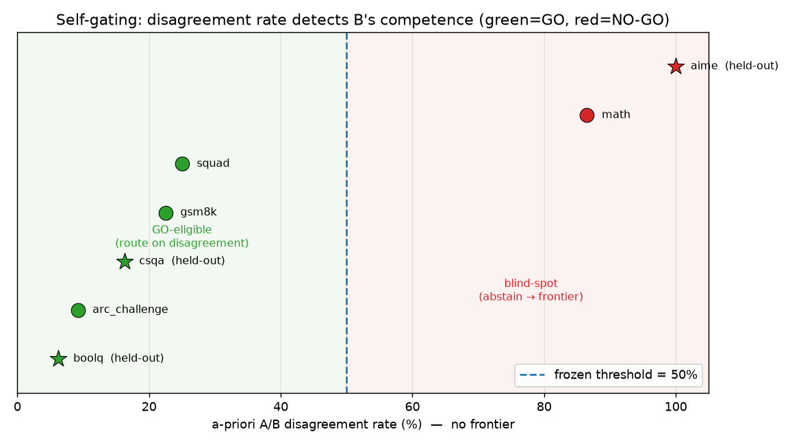
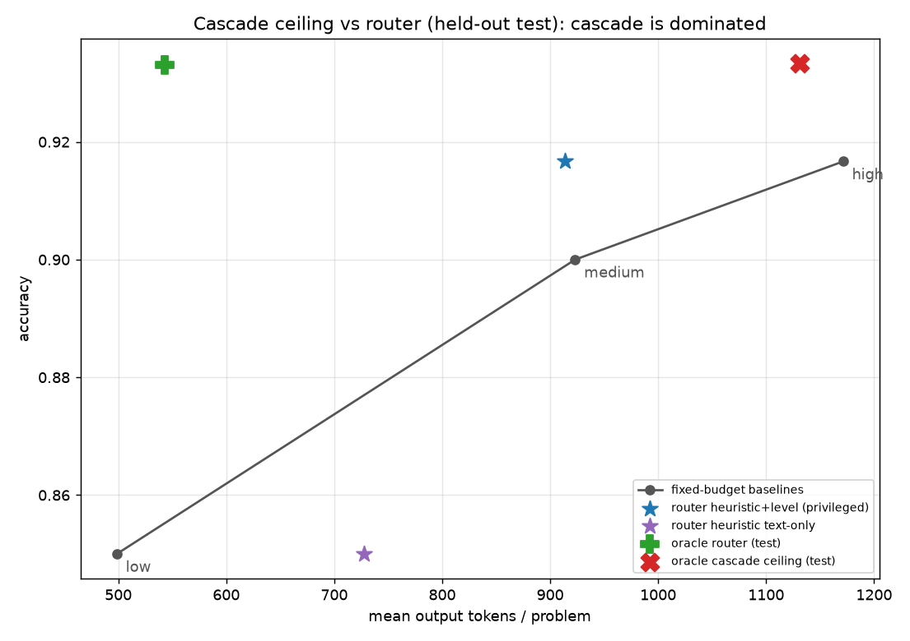
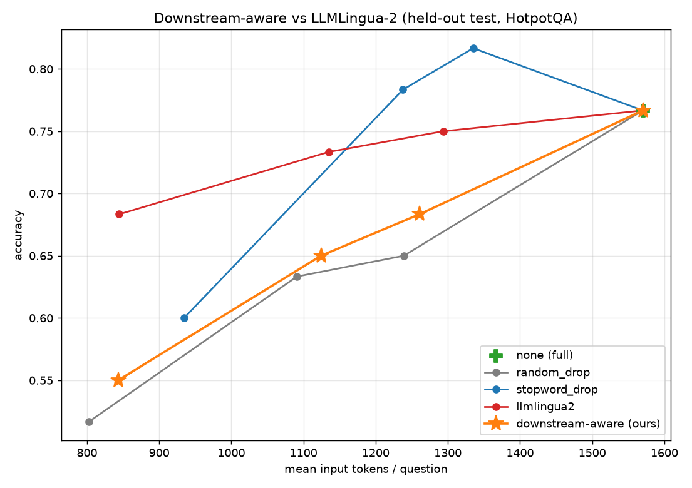
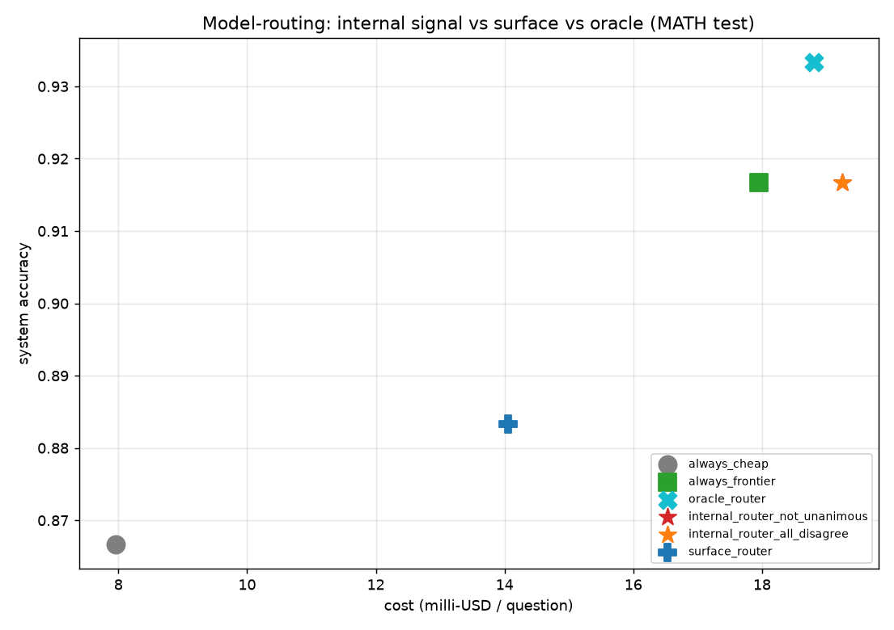
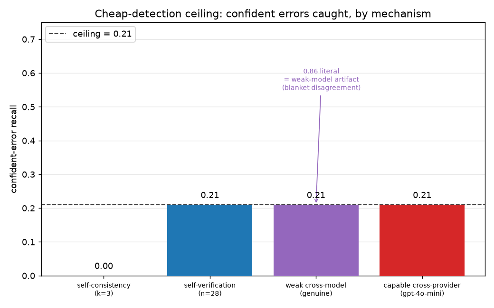
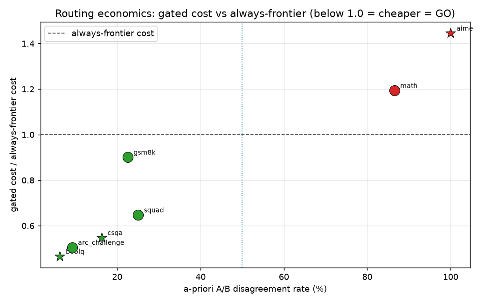
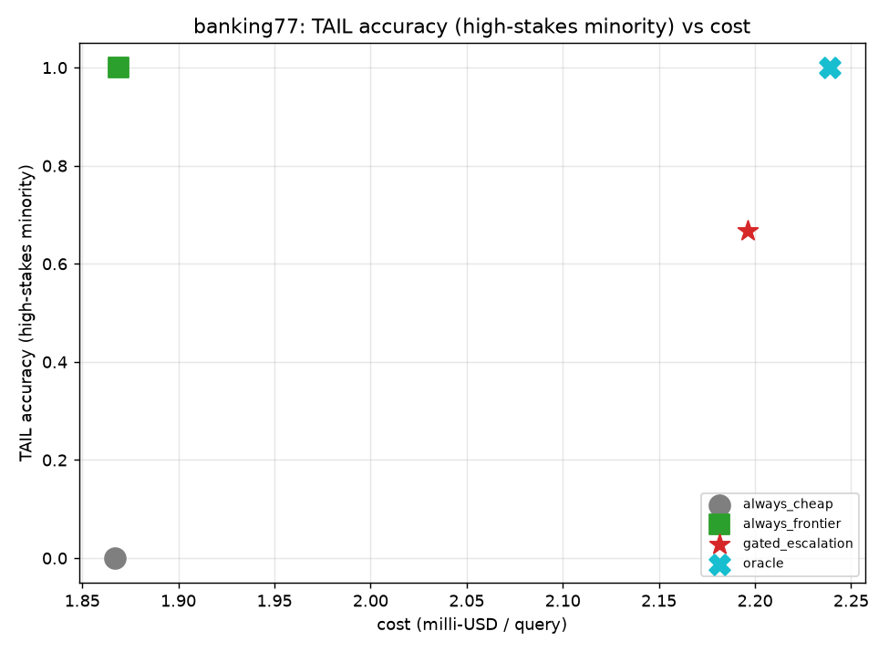
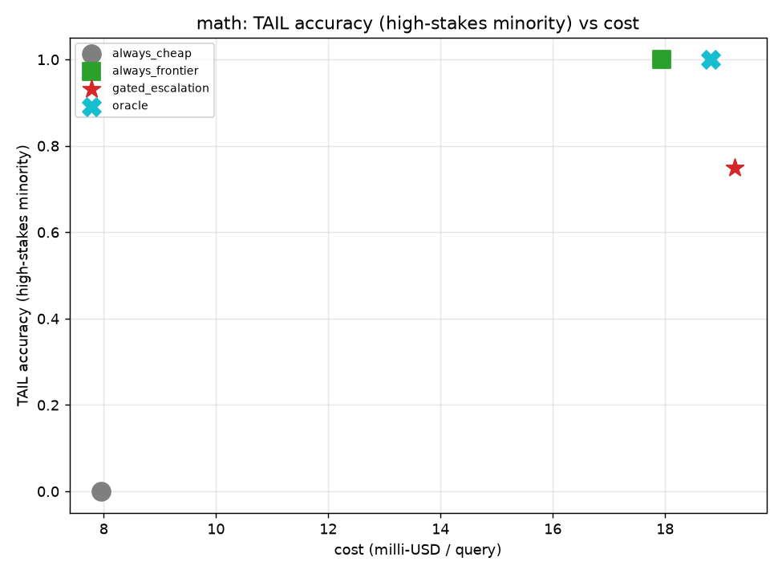
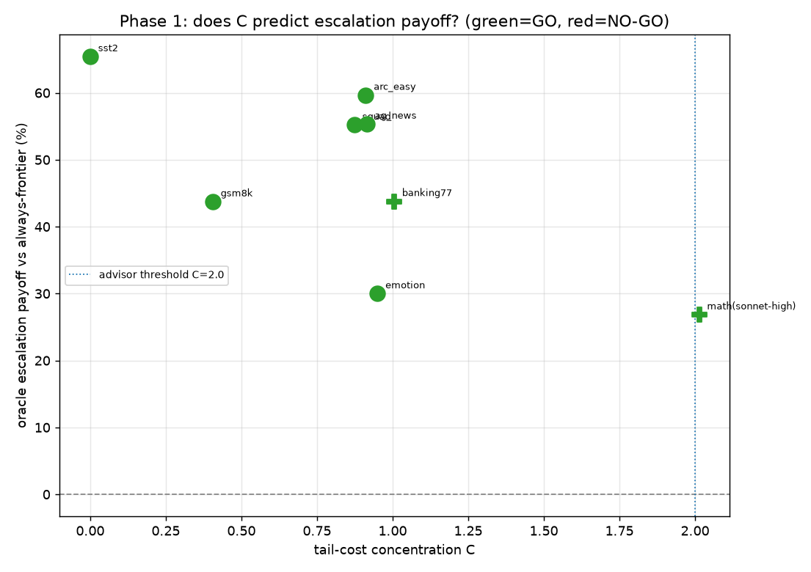

# Cheap-Tier Competence: A Hard Ceiling on Minority Detection, and a Self-Gating Router for LLM Cost Reduction

> A consolidated, oracle-bounded, pre-registered research program on **when you can cheaply
> tell which queries a small model gets wrong — and whether cutting cost on that basis pays.**

**Models:** cheap A = `claude-haiku-4-5` ($1/$5 per MTok) · cheap B = `gpt-4o-mini`
($0.15/$0.60) · frontier = `claude-sonnet-4-6` ($3/$15). **Total API spend:** **$13.81**, all
runs cached and re-runnable. Prices are a dated snapshot (2026-06-29); every cost verdict is
stated relative to it.

---

## TL;DR

We study token reduction through one lens — the **high-stakes minority**: queries a cheap
model gets wrong but a frontier model gets right. Two co-equal findings emerge from eleven
experiments across three levers (output-side reasoning budgets, input-side compression,
cross-model routing):

1. **A hard ceiling on cheap detection.** ~78% of the cheap tier's *confident* errors are
   uncatchable by any cheap signal — the whole cheap tier shares a blind spot there. Three
   independent mechanisms all detect exactly **0.21** of confident errors.
2. **A self-gating router that captures the rest.** Cross-provider disagreement routing pays
   wherever the second cheap model is competent — and it detects *a priori*, from the raw
   disagreement rate alone (no frontier call), **where** it is competent, gating itself on.

One hidden variable — **cheap-tier competence on the workload** — explains both the wall and
the lever.



---

## The spine

> **The economics and detectability of the high-stakes minority** — queries a cheap model
> gets wrong but a frontier model gets right. Detecting that minority cheaply is hard; the
> same minority is also the token-expensive tail; and that co-location decides whether cost
> reduction pays.

Every experiment ladders to this one question.

---

## Part I — Surface features cannot detect the minority

The first hypothesis was a **reasoning-budget router**: predict per-query difficulty, spend
budget proportionally. The oracle router proved the headroom is large and real — **0.945
accuracy at 319 output tokens/problem vs always-high 0.917 at 1171** (higher accuracy at 73%
fewer tokens). But every *cheap* predictor of which problems need more compute collapsed to the
majority: structural features, a level-based heuristic (which only "won" via a privileged
dataset label), and semantic MiniLM embeddings (hard-class recall 0.00–0.11). A confidence
cascade could not rescue it — an *oracle* cascade is itself dominated by the oracle router
(paying a cheap pass first then escalating loses to picking one budget up front).



The input side told the same story. A **downstream-aware compressor** (delete tokens
calibrated on whether deletion flips the answer) **lost to LLMLingua-2 at every rate** because
a cheap classifier could not identify load-bearing spans (recall 0.07; labels were 90%
droppable / 10% load-bearing).



**Conclusion:** cheap surface features cannot capture the signal that matters, on either axis.

---

## Part II — Model-internal signal partly works, and the co-location appears

If surface features can't see the minority, can a model's *own* uncertainty? With no logprobs
available, the signal was **self-consistency** (k samples, agreement). It lifted minority recall
to **0.73** — the first positive — where surface features sat at 0.50. But it did not pay:
every router, *including the oracle*, was dominated by always-frontier on cost (18.8 vs 17.95
milli-USD/query).



The reason is the program's central economic fact: **the high-stakes minority is the
token-expensive tail.** The hard queries and the expensive queries are the *same* queries, so
escalating the minority costs about as much as always paying the frontier. Savings and risk are
co-located — which is exactly why they cannot be cheaply separated.

---

## Part III — The detection ceiling, triply confirmed

Four pre-registered experiments hunted a signal that is both *cheap* and *informative*, focused
on the **confident-error blind spot** — items where the cheap model is *unanimously* wrong
(self-consistency is blind to these by construction).

| signal | confident-error recall |
|---|---|
| self-consistency (k=3) | 0.00 (blind by construction) |
| self-verification (Phase 2, n=7) | 0.43 — exciting, but small-n |
| self-verification (Phase 2.5, n=28) | **0.21** — replicated; real but modest |
| weak-model disagreement (Phase 2.6) | **0.21** genuine (0.86 was a blanket-disagreement artifact) |
| capable cross-provider, gpt-4o-mini (Phase 2.7) | **0.21** — third confirmation |



The interpretation is mechanistic, not coincidental: **~78% of confident errors are the cheap
tier's *shared* blind spot**, and no cheap signal has a vantage point outside it. (Phase 2.5
confirmed self-verification is a *real* mechanism — generation/verification asymmetry survives
a format-leakage control — just modest. Phase 2.6 showed a *weak* second model produces a
spurious 0.86 by disagreeing on everything; its genuine independence is again 0.21, and the
economics correctly reject it.)

---

## Part IV — A working lever, with a precise boundary

Phase 2.7's second finding opened the door. While *confident-error detection* plateaus at 0.21,
*disagreement-gated routing* with a **capable** cross-provider model (gpt-4o-mini) is a realized
**GO on competent domains** — precise (majority-disagree 0.37 vs minority 0.79, unlike the weak
model's blanket disagreement), matched-or-better accuracy than always-frontier, cheaper. It
fails only where the second model is *itself* in the blind spot (competition math, blanket 86%).



**The boundary is the finding:** routing pays iff the second model is competent on the domain.

---

## Part V — The lever becomes self-aware (the capstone)

The lever's validity hinges on one hidden variable — *is the second model competent here?* —
previously knowable only by running the frontier. **Phase 3 shows it is detectable a priori
from the raw A/B disagreement rate alone, with the frontier walled out of the predictor
(enforced in code).**

A threshold frozen at **>50% disagreement → abstain**, committed *before* results, classified
all seven domains correctly — including **three held out of calibration** (boolq, csqa, aime):

| | GO-domains (disagree ≤ 50%) | blind-spots (disagree > 50%) |
|---|---|---|
| in-sample | arc 9%, gsm8k 22%, squad 25% | math 86% |
| **held-out** | **boolq 6%, csqa 16%** | **aime 100%** |

(See the self-gating figure at the top.) The disagreement rate is **self-diagnosing**: a
competent B agrees with A on the easy majority and disagrees only on real errors (low, precise →
route); a blind-spot B is wrong-but-different on everything (blanket → the rate itself says
"don't trust me here"). **The router knows when to turn itself on.**

---

## The shippable artifact

A **self-gating cross-provider disagreement router**:

1. Run a small *unlabeled* sample through both cheap models (A, B); measure the **A/B
   disagreement rate**. No frontier.
2. **> 50%** → B is blind here → **abstain** (route to frontier; no savings, no harm).
3. **≤ 50%** → B is competent → **route on disagreement**: answer cheaply when A and B agree,
   escalate to frontier when they disagree. Realized GO: matched-or-better accuracy, 9–25%
   escalation, cheaper than always-frontier.

Plus the **Quality-Aware Lever Advisor** (`advisor/`) — a diagnostic that, on an operator's own
traffic, reports **minority size**, **g-aware tail-cost concentration**, and **signal recall**,
and returns GO/NO-GO with **tail quality** quantified — the decision shipping routers (RouteLLM,
gateways) and observability tools (Braintrust, Galileo) do not surface. The decision rule is the
g-aware break-even `C_w < (1 − 1/g)/w`.

The tool's differentiator is reporting quality **on the minority**, not the average — where
cost-cutting silently fails:

| BANKING77 (flat cost → GO) | MATH (concentrated tail → NO-GO) |
|---|---|
|  |  |

Phase 1 calibration falsified an earlier fixed-`C` threshold and produced the corrected g-aware
rule (the GO/NO-GO line moves with signal cost, not workload shape):



---

## Methodology (a first-class result)

The findings are only as trustworthy as the process. The program held to:

- **Oracle bounds on every lever** — a negative means "the headroom is real and here is what
  blocks it," not "we couldn't do it."
- **Pre-registration where it mattered** — win/fail thresholds frozen in writing *before*
  results, including the threshold *values*; validated out-of-sample, not tuned in-sample.
  (`advisor/PHASE*_PREREG.md`.)
- **Re-derivation, never threshold-fishing** — when a result looked wrong, the fix came from
  cached data, not a moved goalpost.
- **Honest effect sizes** — `n` reported inline on every recall figure; weak passes reported as
  weak; per-workload, never only pooled.
- **Caching, cost-gating, fixed seeds, logged configs; every result dated to its price snapshot.**

This produced, on the record: a **retracted** product-validation claim
(`advisor/results/CORRECTION.md`), a breakthrough **downgraded** from 0.43 to 0.21 against a
pre-registered bar, and an **artifact caught** when a literal recall of 0.86 was shown to be a
weak-model blanket-disagreement and reported as such. Most work in this area reports the 0.86.

---

## Experiment ledger

| # | Experiment | Verdict | Headline |
|---|---|---|---|
| 1 | Reasoning-budget router (output) | NEGATIVE | Difficulty latent; predictors collapse (recall ~0). Oracle 0.945@319 vs 0.917@1171 — real, unreachable. |
| 2 | Confidence cascade | NEGATIVE | Oracle cascade 0.930@555 dominated by oracle router 0.945@319. |
| 3 | Semantic-embedding difficulty | NEGATIVE | Not in MiniLM embeddings; hard-recall 0.00–0.11. |
| 4 | Model-routing / gating signal | MIXED | Self-consistency detects (recall 0.73, first positive) but doesn't pay (18.8 vs 17.95 m$/q). |
| 5 | Downstream-aware compressor (input) | NEGATIVE | Loses to LLMLingua-2; load-bearing recall 0.071. |
| P1 | Advisor calibration | CORRECTION | Fixed-C falsified → g-aware rule; "validated by shape" retracted. |
| P2 | Self-verification vs ceiling | BREAKTHROUGH (tempered) | Cracks blind spot (3/7); MATH→GO (0.900 acc, 23% cheaper, g=4.39). |
| P2.5 | Replication + leakage test | HOLD | Recall replicates at 0.21 (n=28) < 0.30 bar; mechanism real (not leakage). |
| P2.6 | Weak cross-model | CONSOLIDATE | 0.86 artifact; genuine independence 0.21; economics fail. |
| P2.7 | Capable cross-provider | TWO-PART | Ceiling 3rd confirm (0.21); routing GO on 3/4 competent domains. |
| P3 | Self-gating competence | **CAPSTONE — WORKS** | A/B disagreement detects competence a-priori; 7/7 incl. 3 held-out; frontier walled off. |
| — | Quality-Aware Lever Advisor | BUILT | Minority size, g-aware tail-cost concentration, tail quality on own traffic. |

---

## Honest boundaries

- **One held-out blind-spot domain.** Blind-spot detection generalized (AIME), but the
  blind-spot class rests on two points (MATH, AIME), both competition math. A blind spot of a
  *different shape* (specialized vocabulary, long-context) is untested — the one sequel
  experiment.
- **Price-regime contingency.** Every `g` and cost verdict depends on a dated snapshot; the 3×
  cheap/frontier gap is not permanent. Findings refresh on re-run.
- **Sample sizes.** n≈200/workload; confident-error sets n≈28. The 0.21 ceiling is robust across
  three mechanisms but each estimate is modest-n.
- **Two model families, specific datasets.** Convergence across lanes and providers is evidence
  for generality, but breadth beyond these settings is a hypothesis this program motivates, not
  one it proves.

---

## Repository layout & reproduction

```
router/       output-side experiments (reasoning-budget router, cascade, semantic, gating)
compressor/   input-side experiment (downstream-aware compressor vs LLMLingua-2)
advisor/      the product + Phases 1–3 (calibration, signal hunt, self-gating)
figures/      curated Pareto plots + summary figures used in this README
CONSOLIDATION.md   long-form consolidation (this README is the figure-bearing version)
PROGRAM_REPORT.md  experiment ledger overview
```

Everything re-runs from cache for **$0**. Each experiment has a report under `*/results/*.md`
and (from Phase 1 on) a frozen pre-registration under `advisor/PHASE*_PREREG.md`.

**To use the advisor on your own traffic:**
```bash
python advisor/advise.py --workload banking77        # built-in validation set
python advisor/advise.py --records my_traffic.json   # your sampled traffic
```

API keys are read from environment or a gitignored `.env`; **no keys are committed**.

---

## Conclusion

The spine question is answered end to end. The hardest core of the high-stakes minority is
*undetectable cheaply* — a hard ceiling at the cheap tier's shared blind spot, proven three
ways. Everything inside that ceiling, where a second cheap model is competent, is captured by a
cross-provider disagreement router that *knows where it is competent* from a signal costing
nothing to compute. One hidden variable — cheap-tier competence — explains both the wall and the
lever. The contribution is two-fold and co-equal: the **findings**, which tell you where the
walls are, and the **method**, which is why the walls can be trusted to be real.
